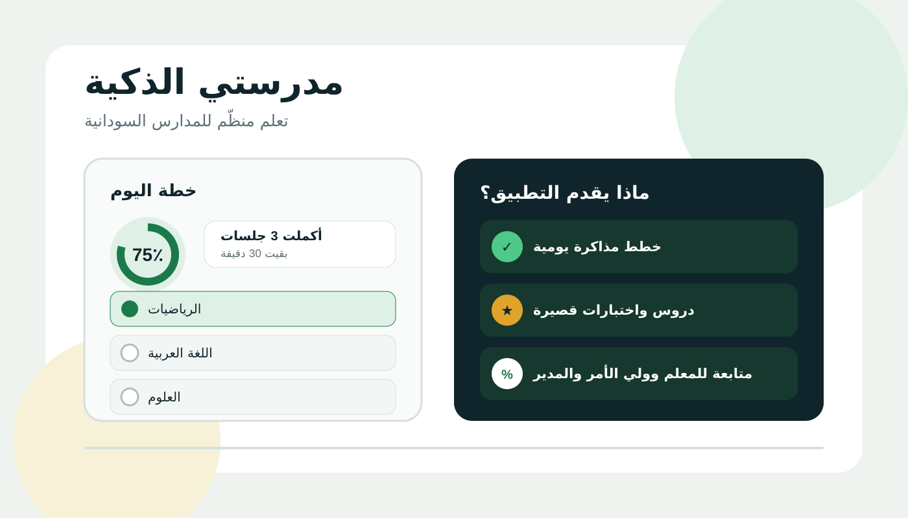
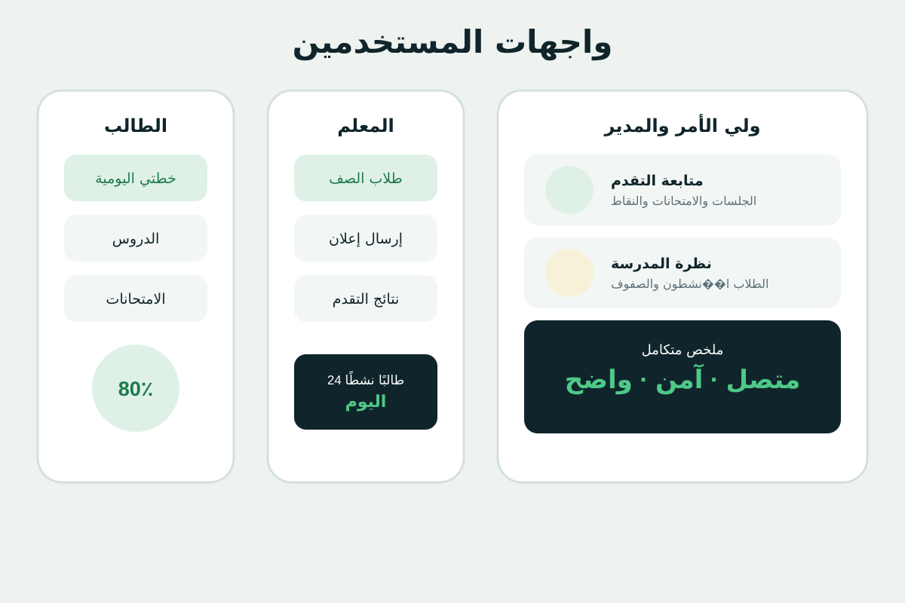

# مدرستي الذكية

منصة تعليمية ذكية للمدارس السودانية، مصممة لتخدم الطالب والمعلم وولي الأمر ومدير المدرسة من واجهة عربية واحدة.

## الواجهات الرئيسية

## المميزات

- خطط مذاكرة يومية بحسب الصف وعدد ساعات المذاكرة.
- دروس واختبارات قصيرة لمواد المرحلة الأساسية والثانوية.
- تتبع النقاط والأوسمة وسلسلة الأيام المكتملة.
- لوحة للمعلم لمتابعة الطلاب وإرسال الإعلانات.
- لوحة لولي الأمر لمتابعة تقدم الابن أو الابنة برمز الطالب.
- نظرة إدارية شاملة للمدرسة والطلاب النشطين.

## تطبيق أندرويد

يتضمن المستودع مشروع Android يغلّف واجهة الويب كتطبيق محلي باسم **مدرستي الذكية**.

للتشغيل والنشر، راجع [دليل تطبيق أندرويد](ANDROID.md).

## حالة المشروع

هذه نسخة تجريبية وواجهات تصميمية للعرض والتطوير. يتطلب الإصدار العام ربطًا بقاعدة بيانات ومصادقة حقيقية ومراجعة المحتوى التعليمي.
